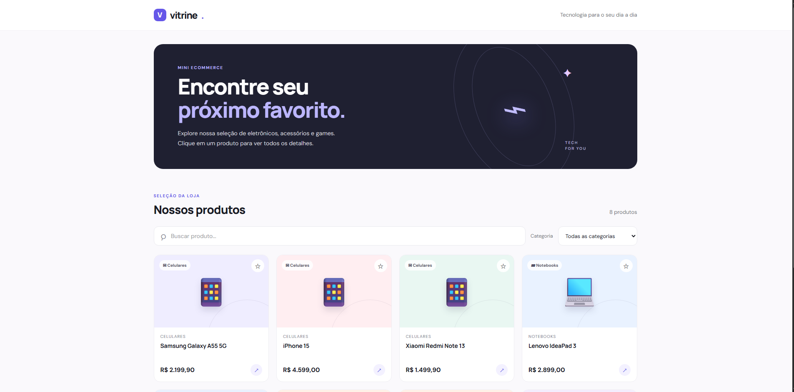
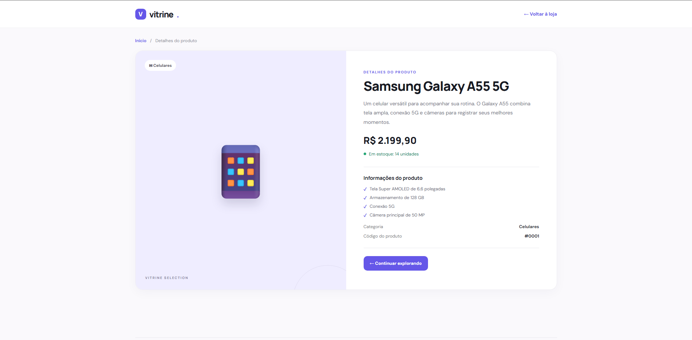

# Mini Ecommerce — Vitrine

Projeto individual desenvolvido para a atividade prática da Semana 11 de TIAW. O site funciona como uma vitrine virtual de eletrônicos: a página inicial apresenta os produtos e cada produto abre uma página com seus detalhes.

## Identificação

- **Aluno:** Bernardo Almeida Andrade
- **Curso:** Engenharia de Software — PUC Minas
- **Disciplina:** TIAW
- **Matrícula:** `931797`

## Funcionalidades

- Mostra os cards dos produtos dinamicamente a partir dos dados definidos em `app.js`.
- Permite buscar produtos por nome, categoria ou descrição.
- Permite filtrar o catálogo por categoria.
- Permite destacar um produto com o botão de estrela.
- Abre uma página de detalhes usando o identificador do produto na query string, por exemplo: `detalhes.html?id=1`.
- Exibe nome, categoria, preço, estoque, descrição e especificações do produto.
- Mostra mensagens para buscas sem resultados e identificadores de produto inválidos.
- Adapta o layout para telas menores.

## Tecnologias utilizadas

- HTML5
- CSS3
- JavaScript puro, sem frameworks

## Como executar

Abra o arquivo `index.html` em um navegador. Clique em qualquer produto para acessar sua página de detalhes. Para testar diretamente a página de detalhes, use um endereço como `detalhes.html?id=1`.

## Estrutura de arquivos

```text
├── index.html       # Página inicial e espaço onde os cards são inseridos
├── detalhes.html    # Estrutura da página dinâmica de detalhes
├── styles.css       # Estilos das duas páginas
├── app.js           # Dados dos produtos e funções de renderização
├── prints/          # Imagens de tela para documentar o projeto
└── README.md        # Descrição e instruções do projeto
```

## Prints do projeto

Salve as capturas de tela com estes nomes e caminhos dentro do repositório. Depois, elas aparecerão aqui no README:

1. `prints/home-page.png` — página inicial mostrando os cards.
2. `prints/detalhes-produto.png` — página de detalhes de um produto.





## Dados dos produtos

Os dados abaixo são mantidos no array `produtos` do arquivo `app.js` e alimentam os cards e a página de detalhes.

```json
[
  {
    "id": 1,
    "nome": "Samsung Galaxy A55 5G",
    "categoria": "Celulares",
    "preco": 2199.9,
    "estoque": 14,
    "descricao": "Um celular versátil para acompanhar sua rotina. O Galaxy A55 combina tela ampla, conexão 5G e câmeras para registrar seus melhores momentos.",
    "especificacoes": ["Tela Super AMOLED de 6,6 polegadas", "Armazenamento de 128 GB", "Conexão 5G", "Câmera principal de 50 MP"]
  },
  {
    "id": 2,
    "nome": "iPhone 15",
    "categoria": "Celulares",
    "preco": 4599,
    "estoque": 8,
    "descricao": "Desempenho rápido, câmera avançada e acabamento elegante em um smartphone pensado para fotos, vídeos e tarefas do dia a dia.",
    "especificacoes": ["Tela Super Retina XDR de 6,1 polegadas", "Armazenamento de 128 GB", "Câmera principal de 48 MP", "Conector USB-C"]
  },
  {
    "id": 3,
    "nome": "Xiaomi Redmi Note 13",
    "categoria": "Celulares",
    "preco": 1499.9,
    "estoque": 21,
    "descricao": "Uma opção equilibrada para quem procura tela fluida, boa autonomia e bastante espaço para aplicativos, fotos e arquivos.",
    "especificacoes": ["Tela AMOLED de 6,67 polegadas", "Armazenamento de 256 GB", "Bateria de 5.000 mAh", "Câmera principal de 108 MP"]
  },
  {
    "id": 4,
    "nome": "Lenovo IdeaPad 3",
    "categoria": "Notebooks",
    "preco": 2899,
    "estoque": 6,
    "descricao": "Notebook para estudos, trabalho e navegação. Seu formato leve facilita levar o computador para a faculdade ou para o escritório.",
    "especificacoes": ["Tela Full HD de 15,6 polegadas", "Processador AMD Ryzen 5", "Memória RAM de 8 GB", "SSD de 256 GB"]
  },
  {
    "id": 5,
    "nome": "Acer Aspire 5",
    "categoria": "Notebooks",
    "preco": 3499,
    "estoque": 5,
    "descricao": "Um notebook com bom espaço de armazenamento e desempenho para atividades acadêmicas, produtividade e entretenimento.",
    "especificacoes": ["Tela Full HD de 15,6 polegadas", "Processador Intel Core i5", "Memória RAM de 8 GB", "SSD de 512 GB"]
  },
  {
    "id": 6,
    "nome": "Headset HyperX Cloud Stinger 2",
    "categoria": "Acessórios",
    "preco": 299.9,
    "estoque": 18,
    "descricao": "Headset confortável para longas sessões de jogo e chamadas. Conta com microfone integrado e controles acessíveis no próprio fone.",
    "especificacoes": ["Áudio com conexão P2", "Microfone com cancelamento de ruído", "Controles no próprio headset", "Estrutura leve e confortável"]
  },
  {
    "id": 7,
    "nome": "Mouse Logitech G203",
    "categoria": "Acessórios",
    "preco": 169.9,
    "estoque": 32,
    "descricao": "Mouse gamer com formato confortável, iluminação personalizável e sensibilidade ajustável para diferentes estilos de jogo.",
    "especificacoes": ["Sensor ajustável até 8.000 DPI", "6 botões programáveis", "Iluminação RGB", "Conexão USB com fio"]
  },
  {
    "id": 8,
    "nome": "PlayStation 5 Slim",
    "categoria": "Games",
    "preco": 3699,
    "estoque": 4,
    "descricao": "Console para aproveitar jogos atuais com carregamentos rápidos, gráficos detalhados e uma grande variedade de experiências.",
    "especificacoes": ["Armazenamento SSD de 1 TB", "Inclui controle sem fio", "Compatível com jogos de PS5", "Conexão HDMI e Wi-Fi"]
  }
]
```

> Os produtos e valores são fictícios e foram incluídos para demonstrar o funcionamento do catálogo.
